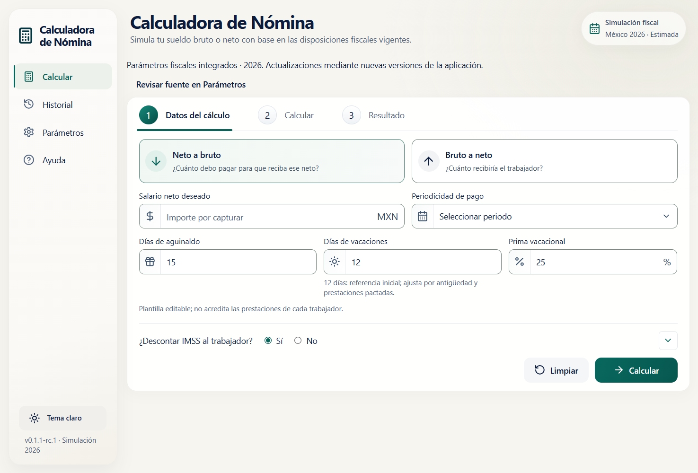
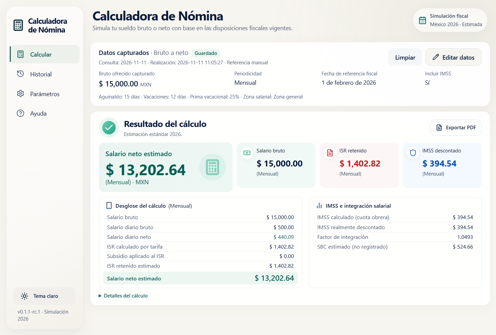
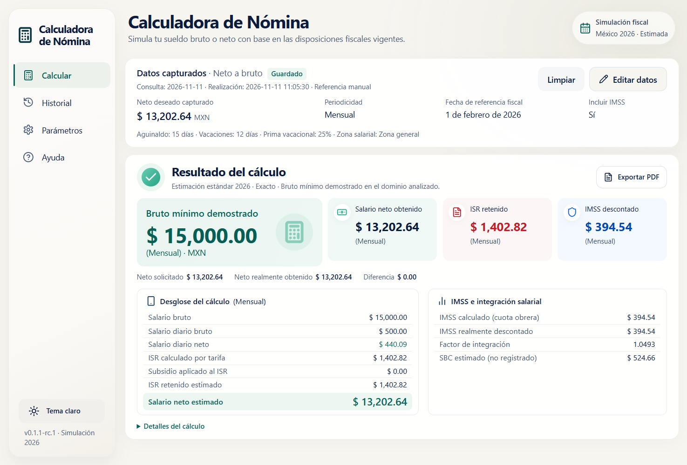
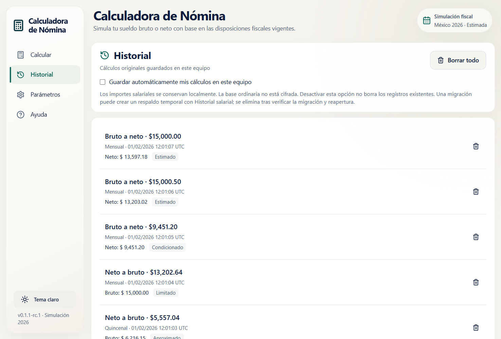
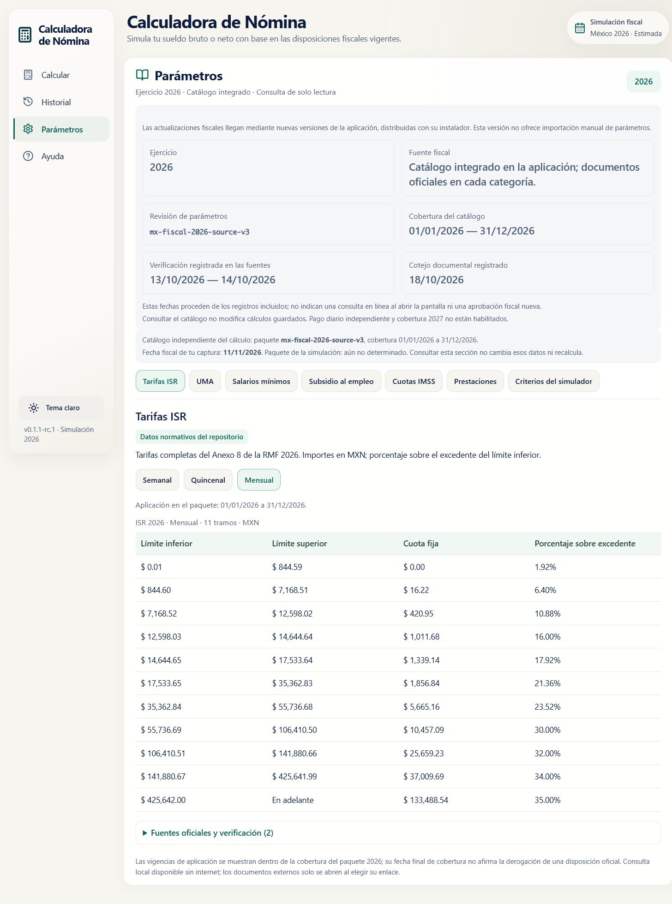

<p align="center">
  
</p>

<h1 align="center">Calculadora de Nómina</h1>

<p align="center">
  Calcula tu salario bruto y neto en México de forma local, sin cuentas y sin enviar tus datos a ningún servidor.
</p>

<p align="center">
  <a href="https://github.com/JosueLuceroG/calculadora-nomina/releases/latest">
    
  </a>
  
  
</p>

## Descargar

La forma más fácil es abrir la página de [versiones](https://github.com/JosueLuceroG/calculadora-nomina/releases/latest) y descargar el instalador para Windows 11 de 64 bits.

| Instalador | Tamaño | Cuándo usarlo |
| --- | --- | --- |
| Normal | 6.9 MB | Si tu equipo ya tiene WebView2 o puede descargarlo durante la instalación. |
| Offline | 223 MB | Si no tienes internet o prefieres llevar todo incluido. |

Después de descargar, puedes comprobar el archivo con el `SHA-256` que aparece en la misma versión. El instalador todavía no tiene firma digital, así que Windows puede mostrar un aviso de SmartScreen o “editor desconocido”. Es normal en esta versión de prueba.

> **Importante:** esta aplicación hace una estimación. No es CFDI, no sustituye SUA o CONTPAQi y no es una asesoría fiscal.

## Qué puedes hacer

- Pasar de salario bruto a neto y de neto a bruto.
- Ver el desglose de ISR, subsidio al empleo e IMSS.
- Consultar salario diario, factor de integración, SDI y SBC estimado.
- Guardar tus cálculos en un historial local.
- Exportar resultados y cálculos guardados a PDF.
- Usar tema claro u oscuro.

### Un ejemplo

Un salario mensual de **$15,000.00** con prestaciones 15/12/25 e IMSS estimado da un neto de **$13,202.64**. Si desactivas IMSS, el resultado es **$13,597.18**.

Los importes son estimaciones bajo el perfil que declares. La aplicación no adivina prestaciones, ingresos variables ni incidencias.

## Capturas

<p align="center">
  
  
</p>

<p align="center">
  
  
</p>

También puedes ver la [ayuda integrada](docs/screenshots/04-ayuda.png), el [historial completo](docs/screenshots/05b-historial-completo.png) y un [reporte PDF de ejemplo](docs/ejemplos/reporte-ejemplo.pdf).

## Cómo usarla

1. Descarga e instala la aplicación.
2. Elige el periodo, escribe el monto y revisa los datos del cálculo.
3. Consulta el desglose, guarda el resultado o expórtalo a PDF.

No necesitas crear una cuenta. Después de instalar, el cálculo funciona sin conexión.

## Tus datos

- El historial y las preferencias se guardan en tu equipo, en `%LOCALAPPDATA%\mx.calculadoranomina.desktop\payroll.sqlite3`.
- La base local no está cifrada.
- El guardado automático empieza desactivado en un perfil nuevo.
- Los PDF se guardan en la carpeta que elijas.
- La aplicación no envía tus cálculos a internet.

## Requisitos

- Windows 11 de 64 bits.
- Microsoft Edge WebView2. Windows 11 suele incluirlo; si falta, el instalador normal puede descargarlo.
- Una pantalla que permita una ventana de al menos 900 × 600.

Windows 10 no se validó en esta versión.

## Alcance

Esta versión está pensada para un salario ordinario fijo, totalmente gravado, en la zona general de México y para el ejercicio **2026**. Usa periodos de 7, 15 o 30 días.

Quedan fuera de alcance:

- CFDI, SUA, CONTPAQi y conciliación mensual real.
- Ingresos variables, exentos, incidencias, otros patrones y SBC mixto.
- IMSS manual, pago fiscal diario independiente y el ejercicio 2027.
- Importación manual de paquetes fiscales desde la interfaz.

“IMSS No” no significa una exención legal. El cálculo inverso solo demuestra resultados dentro del dominio y la cobertura que muestra la aplicación.

## Estado

Esta es una versión de prueba. El instalador aún no está firmado, no se ha probado en una instalación limpia de Windows y la revisión fiscal sigue pendiente. Por eso no debe usarse como cálculo oficial ni para tomar decisiones fiscales sin revisión profesional.

## Para desarrolladores

<details>
<summary>Ver comandos, pruebas y estructura</summary>

### Desarrollo

```powershell
npm install
npm run dev
```

Para abrir la aplicación completa:

```powershell
npm run tauri -- dev
```

### Comprobaciones

```powershell
npm run typecheck
npm test
npm run build
cargo test --manifest-path "src-tauri/Cargo.toml" --lib
cargo test --manifest-path "crates/nomina-fiscal-package/Cargo.toml"
```

La suite de Vitest tiene **5,903 pruebas** y los tests Rust suman **323 pruebas** entre la aplicación y el crate fiscal. La documentación técnica explica el motor, la arquitectura y el modelo de paquetes firmados.

### Estructura

```text
src/                    interfaz, cálculo, historial, PDF y pruebas
src-tauri/              aplicación de escritorio y persistencia local
crates/                 verificación de paquetes fiscales
tools/                  herramientas editoriales y de firma
docs/                   documentación, capturas y ejemplos
```

</details>

## Documentación

- [Cómo calcula la aplicación](docs/MOTOR-DE-CALCULO.md)
- [Arquitectura](docs/ARQUITECTURA.md)
- [Paquetes fiscales](docs/PAQUETES-FISCALES.md)
- [Instaladores y hashes](docs/INSTALADORES.md)
- [Reporte PDF de ejemplo](docs/ejemplos/reporte-ejemplo.pdf)

## Licencia

MIT. Consulta [LICENSE](LICENSE).

Las fuentes DejaVu Sans incluidas conservan su propia licencia en `src/features/pdf/assets/LICENSE-DejaVu.txt`.
